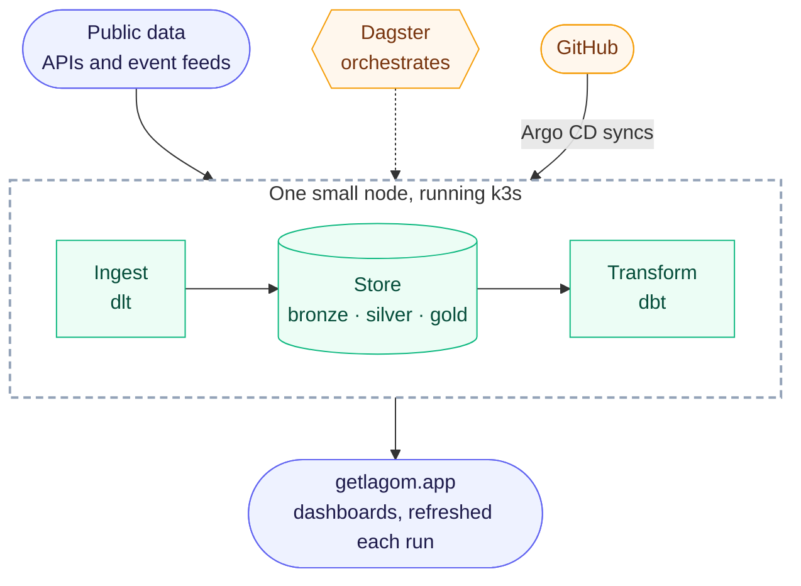

# Lagom Data Solutions

Open-source data stacks doing real analytics on one small server.

Most data is not big data. Sales records, sensor readings, a public API: it
usually fits on a single machine. Yet the default answer is a stack built for
petabytes, with the cost and the operational weight that come with it. This
project goes the other way. It combines open-source tools that are light on
memory into a data platform that runs on one modest node, and measures how
far that gets.

Small does not have to mean fragile. GitOps, tests, data reconciliation and a
rehearsed disaster recovery come with it.

> **Why "Lagom"?** It is a Swedish word for "not too little, not too much,
> just enough". That is the idea here: as much infrastructure as the data
> needs, and no more.

## How it fits together



Data comes in through ingestion jobs that start, do their work, and exit. It
is stored in layers (raw, cleaned, modelled) and transformed with dbt.
Dagster is set to schedule the work from the outside. After each run the
dashboards are rebuilt and published as plain files: the numbers stay fresh,
the charts are interactive in the browser, and no visitor ever reaches the
cluster. Argo CD keeps the cluster in sync
with this repository, so changes arrive through Git, not by hand.

## The stack

| Layer | Tools |
|---|---|
| Ingestion | dlt for APIs, Redpanda Connect for event streams |
| Storage | Postgres today; DuckLake on Cloudflare R2, with Postgres as its catalog, being tested ([ADR-0023](docs/adr/0023-sme-stack-duckdb-on-ducklake.md)) |
| Transformation | dbt, on Postgres or DuckDB |
| Orchestration | Dagster |
| Dashboards | Evidence, rebuilt after each run and published on getlagom.app ([ADR-0023](docs/adr/0023-sme-stack-duckdb-on-ducklake.md)) |
| Platform | k3s on a single ARM node, Argo CD, Sealed Secrets, CloudNativePG, Tailscale |

Each choice is written down with the alternatives it beat and the trade-offs it
accepts, in [`docs/adr/`](docs/adr/). Heavier stacks (Iceberg, Spark, Trino)
come later, as the comparison that shows where the small one stops.

## Learn more

| Read | For |
|---|---|
| [`docs/architecture.md`](docs/architecture.md) | how it is built, the memory budget, and the runbook |
| [`docs/roadmap.md`](docs/roadmap.md) | what exists, what comes next, and what is left out on purpose |
| [`docs/adr/`](docs/adr/) | why things are the way they are |
| [`CONTRIBUTING.md`](CONTRIBUTING.md) | the workflow, before a first pull request |
| [`CLAUDE.md`](CLAUDE.md) and [`docs/engineering-protocol.md`](docs/engineering-protocol.md) | the working rules, for people and AI agents alike |

## Running it

The [runbook](docs/architecture.md#13-runbook) takes an empty server to the
platform as it stands, step by step, with commands that were actually run. After that,
every change reaches the cluster through a pull request.

## Layout

```
platform/   the shared backbone: cluster manifests, Argo CD apps, the dbt project
services/   one directory per data source: ingestion, its tests and image
products/   what people see: the site and its dashboards
tools/      CI checks and operational scripts
docs/       architecture, roadmap, decisions (ADRs), runbook
```

Adding a source or a dashboard is additive: a new directory and its Argo CD
Application ([ADR-0006](docs/adr/0006-monorepo-layout.md)).

## License

MIT — see [`LICENSE`](LICENSE).
